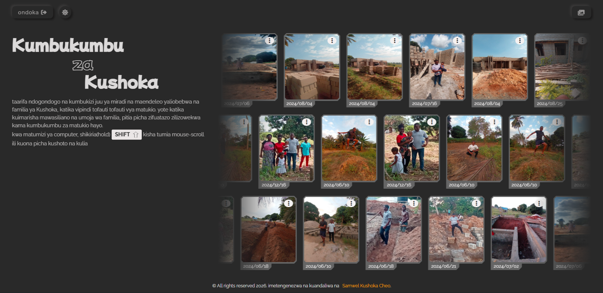

<h1 align="center"><strong>Kumbukumbu za Kushoka</strong></h1>

### A simple Swahili-made image portal, carrying the basic tasks, like viewing , adding, deleting and editing images collection
- #### below is the clear overview of the page 

### Stacks used in the development , provided as follows

### Assets and typography, involved in the project
- `typography`
    - ff-primary: 'Mochiy Pop One';
    - ff-secondary: 'Raleway';
    - ff-sub: monospace;
    - fs-300: 10px;
    - fs-400: 12px;
    - fs-500: 14px;
    - fs-600: 18px;
    - fs-700: 2.5rem; 
    - fw-200: 200;
    - fw-400: 400;
    - fw-500: 500;
    - fw-600: 600;
    - fw-700: 900;

- `color-palette`
    - **light-mode**
        - clr-font: #292929;
        - clr-bg: #f3f1f1;
        - clr-btn: #00000077;
        - clr-image-date: var(--clr-bg);
        - top-shadow: #fff;
        - bottom-shadow: #cacaca;
        - card-bg: #292929;
        - img-hover: var(--card-bg);
        - clr-btn-border: #292929;
    - **dark-mode**
        - clr-font: #f3f1f1e0;
        - clr-bg: #292929;
        - clr-btn: #f3f1f188;
        - top-shadow: #383737;
        - bottom-shadow: #1a1919;
        - clr-p: #f3f1f1ad;
        - card-bg: #6d6d6de0;
        - img-hover: var(--clr-btn);
        - clr-btn-border: #f3f1f169;

    - clr-success: #04cf04;
    - clr-error: red;
    - clr-footer-a: orange;